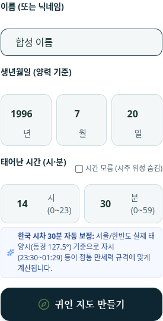
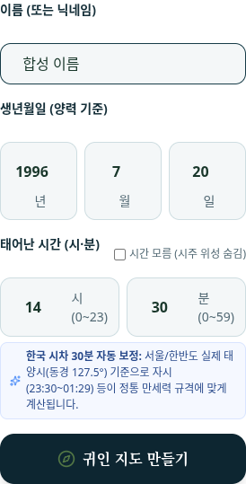
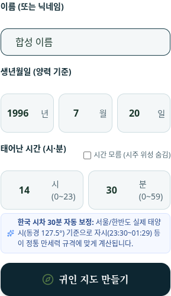

# 지도 이름 비교의 잔여 경계 사례

실제 원격 QA 기준 `c7648b7ac3f8b18c3ac08c4c12931276bb92aee4`와 기존 작업 트리의 clean 상태를 확인하고 별도 `fix/galaxy-name-binding-20261010` 브랜치에서 작업했다. 이전 완료 브랜치와 main은 수정하지 않는다.

`'가'.repeat(49) + ' x'`는 기존 파서의 첫 결과가 49개의 가와 끝 공백, 즉 50 UTF-16 단위다. API는 이 첫 결과를 저장한다. 그런데 지도 비교에서 snapshot 이름을 다시 `trim()`하면 49단위가 되어 저장 이름과 달라진다. API의 이름 정책과 첫 파서 결과를 보존하는 snapshot을 기준으로 대조한다.

`galaxyMatchesSnapshot`과 `universeOwnerKey`에서 두 번째 trim을 없앴다. 처음 파싱한 snapshot 이름과 API 저장 이름을 그대로 비교한다. 끝 공백을 보존한 50단위 결과와 49단위 이름은 다른 소유자 키다. 파서·API·DB 및 다른 입력·사주 검증은 변경하지 않았다.

이전 `b36e98d989a36d098bb3668f89f3d35a8dc1cfa9`의 실제 `calculateUniverse`·`saveGalaxyUniverse` 함수도 같은 입력에서 연결 오류가 났다. 이 함수 대조에는 기준들 사이에서 변경되지 않은 파서·사주 계산·테마 의존성을 사용했다. b36 전체 브라우저 재실행은 아니다. 이번 QA가 새로 만든 회귀라고 주장하지 않고 기존 정책의 잔여 경계 사례로 기록한다.

## 합성 입력과 검사 범위

| 입력 | 기존 API의 저장 이름 |
| --- | --- |
| `  합성 이름  ` | `합성 이름` |
| `  합성  이름  ` | 내부 공백 두 개 유지 |
| 49개의 가 + 공백 + x | 49개의 가 + 끝 공백, 50단위 |
| 48개의 가 + 공백 + 😀 | 48개의 가, 48단위 |
| 49개의 가 + 😀 | 49개의 가, 49단위 |
| 48개의 가 + 😀 | 48개의 가 + 완전한 pair, 50단위 |
| 빈 문자열·공백 세 개 | 폼 제출 차단, API 400 |

이름 6개를 320·359·360·375·390px에서 소유자·주변인 폼으로 제출한다. 저장 응답, 실제 D1 저장 수, 이름의 DOM 텍스트·입력값, 재열기·새로고침 및 실제 GET 결과를 대조한다. 공백을 가진 결과도 검사에서 다시 trim하지 않는다. 빈 이름은 각 폭에서 두 폼을 검사하고 실제 API가 400을 반환하며 저장을 추가하지 않는지 확인한다. 성공하는 자료의 생성·변경은 모두 실제 폼에서 발생한다.

저장 후 로컬 검증 오류가 나면 같은 폼을 한 번 더 눌러 재시도 응답과 실제 행 수를 기록한다. 이 검사는 성공을 실패로 안내해 생기는 재시도 경로를 다룬다. 명시적인 새 지도 생성이나 네트워크 재전송에 대한 서버 멱등성은 검증하거나 추가하지 않는다.

날짜 숫자는 Chromium의 실제 `editing-view-port` 너비와 Canvas의 글자 너비를 비교한다. 폼과 입력·버튼의 화면 경계, 가로 넘침, 고정 하단 메뉴의 버튼 가림도 검사한다. 오류 처리 후 상태까지 같은 측정을 반복한다.

360px의 원본 연도 편집 영역은 36.109375px, 글자의 advance는 36.608093px였다. 기존 1px 허용오차만으로는 통과했으므로 Canvas의 실제 글자 획 경계도 측정하고 0.01px 한도를 추가했다. 가운데 정렬된 연도 획이 약 0.249359px 밖으로 나가는 것을 기본·오류 상태에서 재현했다. 날짜 단위의 가로 배치 전환만 360px에서 375px로 늦췄다. 320·359px은 기존 세로 배치, 375·390px은 기존 가로 배치다. 카드 여백·글꼴·숫자 버튼은 그대로다.

## 검증 결과

| 검사 | 원본 | 수정 후 |
| --- | --- | --- |
| 실제 브라우저 폼 281개 | 27개 실패: 이름·연결 15개, 360px 글자 경계 12개 | 281개 통과 |
| 프런트 세션 12개 | 3개 실패 | 모두 통과 |
| 기존 이름 28개·지도 로딩 DOM 7개 | 기존 검사 유지 | 모두 통과; 세션 포함 Node 총 47개 |
| 타입·빌드·변경 코드 lint | 원본 빌드 성공; 타입·lint 대조 미실행 | 종료 코드 0; lint 오류 0개·기존 경고 1개 |

원본에서는 다섯 폭의 `cut-space` 모두 실제 POST 200·D1 1행 저장 뒤 검증 오류 alert가 나왔다. 같은 폼을 한 번 더 제출하면 또 200을 반환하고 다른 ID의 행이 추가돼 2행이 됐다. 수정본 소유자 생성 30건은 모두 200·1행 저장·정상 이동이며 이 실패 안내나 재시도 경로가 발생하지 않았다. 저장 이름 60건을 정확히 대조했고, 빈 이름 API 검사 20건은 400·폼 쓰기 0건이었다.

기존 QA의 65개 검사 이름은 이번 281개의 전체 통과 결과에 모두 포함된다. 소유자·주변인의 기본·오류 처리 후 배치 120개에서 가로 넘침 0, 버튼 중심의 클릭 가림 없음, 숫자 획 경계 넘침 0을 확인했다. 외부 호출과 브라우저 예외도 없었다.

연도 advance는 두 빌드에서 약 36.608px로 동일하다. 편집 영역과 획 경계 측정은 다음과 같다.

| 화면 폭 | 원본 편집 영역 | 수정본 편집 영역 | 원본 획 넘침 | 수정본 획 넘침 |
| --- | --- | --- | --- | --- |
| 320px | 41px | 41px | 0 | 0 |
| 359px | 52.703px | 52.703px | 0 | 0 |
| 360px | 36.109px | 53px | 0.249px | 0 |
| 375px | 40.609px | 40.609px | 0 | 0 |
| 390px | 45.109px | 45.109px | 0 | 0 |

아래는 수정본의 실제 소유자 폼이다. 이미지 편집 없이 브라우저가 캡처한 파일을 보존했다.

| 359px | 360px | 375px |
| --- | --- | --- |
|  |  |  |

## 재실행

Node 24.19.0, Playwright 1.62.1, Chromium 151.0.7922.173을 사용한다. 브라우저·DOM 검사 도구는 별도 임시 경로에 설치하며 앱 의존성 파일은 변경하지 않는다.

```bash
npm run install:ci
npm install --prefix /tmp/saju-map-binding-qa --cache /tmp/saju-map-binding-npm-cache --no-save --package-lock=false playwright@1.62.1 jsdom@26.1.0
export SAJU_QA_PLAYWRIGHT_PATH=/tmp/saju-map-binding-qa/node_modules/playwright/index.mjs
export SAJU_QA_JSDOM_PATH=/tmp/saju-map-binding-qa/node_modules/jsdom/lib/api.js
export SAJU_QA_CHROME=/usr/bin/chromium
node --test --test-reporter=tap scripts/qa/map-name-session.mjs scripts/qa/name-normalization.mjs scripts/qa/guin-map-loading-dom.mjs
npx tsc --noEmit --incremental false
npx eslint app/guin/page.tsx lib/universe-state.ts scripts/qa/map-name-forms-browser.mjs scripts/qa/map-name-session.mjs
npm run build
SAJU_QA_PROFILE=name-binding node scripts/qa/map-name-forms-browser.mjs
```

브라우저 기본 profile은 이전 320·390px의 65개 검사다. `name-binding` profile은 추가 사례와 다섯 폭을 검사한다. `SAJU_QA_FORM_WIDTH=360 SAJU_QA_FORM_CASE=cut-space`로 범위를 좁힐 수 있다. 보고서의 실제 coverage를 기준으로 결과를 해석한다.

원본 대조는 별도 기준 작업 트리에 현재 QA 파일 두 개만 복사하고 같은 명령을 실행한다. `SAJU_QA_PHASE=before`는 보고서 이름만 선택한다. 현재 기준에서 예상되는 실패와 저장 재시도는 합성 데이터에만 발생한다.

이번 원본 브라우저 대조는 앱 소스를 수정하기 전에 완성한 원본 빌드로 실행했다. 검사 동안 그 빌드의 JavaScript·CSS 파일 146개를 유지하고 체크섬을 대조하며, 원본 검사가 끝난 다음 수정본을 빌드한다.

```bash
saju_binding_replay_checkout=$(mktemp -d)
git worktree add --detach "$saju_binding_replay_checkout" c7648b7ac3f8b18c3ac08c4c12931276bb92aee4
cp scripts/qa/map-name-session.mjs scripts/qa/map-name-forms-browser.mjs "$saju_binding_replay_checkout/scripts/qa/"
ln -s "$PWD/node_modules" "$saju_binding_replay_checkout/node_modules"
(
  cd "$saju_binding_replay_checkout"
  node --test --test-reporter=tap scripts/qa/map-name-session.mjs
  npm run build
  SAJU_QA_PROFILE=name-binding SAJU_QA_PHASE=before node scripts/qa/map-name-forms-browser.mjs
)
```

운영 계정·DB를 사용하지 않고 합성 신원과 영속하지 않는 로컬 Worker/D1만 사용한다. 브라우저는 소프트웨어 WebGL로 실제 지도 UI를 로드한다. 실기기·모바일 키보드·운영 로그인과 3D 외형은 이 검사의 범위 밖이다. 네이티브 alert의 문구와 처리 동작은 확인하지만 브라우저·OS 팝업 외곽 크기는 페이지 DOM으로 측정하지 않는다.

원시 전후 JSON·로그·전체 스크린샷과 과거 함수 대조는 Git에서 제외되는 `outputs/galaxy-name-binding/`에 보존한다. main 병합, PR, 배포, 새 인증 또는 권한 변경은 수행하지 않는다.

ESLint의 경고 1개는 기준에도 있는 `app/guin/page.tsx:59`의 `window.location.assign()`이다. 이 호출은 변경하지 않았다. 프로젝트에는 `npm test` 명령이 없어 관련 Node 검사와 실제 폼 검사를 실행한다. 일반 DB·Worker QA는 중복 실행하지 않는다.
