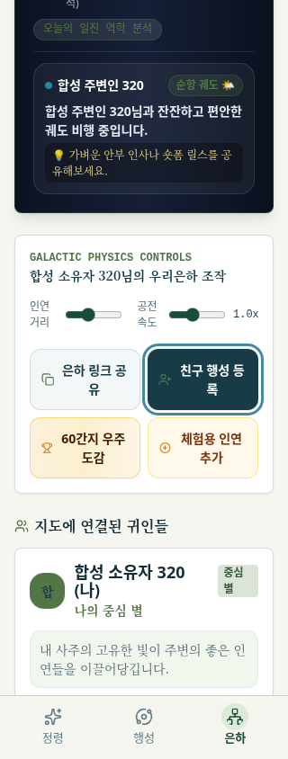

# 지도 소유자·주변인 폼의 키보드 검사

기준은 실제 원격에서 확인한 `caf265e529edd689f1ff7d33ed5e573cb397cc68`이다. 기존 작업 트리 11개의 clean 상태를 확인한 뒤 독립 `fix/galaxy-form-keyboard-20261010` 브랜치에서 작업했다. 기준 Git 객체의 `git archive`로 만든 임시 사본과 수정본에 같은 최종 브라우저 검사 파일을 실행했다.

소유자·주변인 폼의 Enter 제출, 주변인 폼의 Escape 닫기와 닫기 버튼, 초안 보존, 시간 모름에 따른 입력 제거는 원본에서도 동작했다. 해당 동작의 핸들러는 변경하지 않았다. 원본에서 다음 초점 문제가 재현됐다.

| 사례 | 원본 관찰 | 변경 |
| --- | --- | --- |
| 주변인 폼 열기 | 배경의 등록 버튼에 초점이 남음 | 이름 입력에 초기 초점 |
| 모달의 처음·마지막에서 Tab/Shift+Tab | 가려진 배경 요소 또는 body로 이동 | 현재 활성 입력과 버튼 안에서 순환 |
| Escape·닫기 버튼·정상 저장 후 닫기 | body에 초점이 남음 | 원래 등록 버튼으로 복귀 |
| 제출 버튼에서 Enter, 잘못된 날짜로 API 400 | 버튼 비활성화 후 body에 초점이 남음 | 폼이 계속 열려 있으면 내부로 초점 회복 |
| 390px 소유자 폼의 년·월·일 | 입력 상자의 y=800~844, 하단 메뉴가 입력 중심을 덮음 | 가려지는 초점 대상만 화면 안으로 스크롤 |

초점 복귀는 실제 버튼 여부와 가시성을 함께 검사한다. 초점 처리만 보완했던 중간 수정본에서 320px 저장 후 버튼이 y=750.9375~818.9375에 있어 하단 메뉴에 가려지는 것을 재현했다. 복귀한 버튼에도 필요한 경우에만 스크롤을 적용했다. 최종 소유자 년·월·일은 390px에서 y=400~444로 나타나며 입력 중심의 hit test도 실제 입력을 가리킨다.

앱 수정은 두 페이지의 초점 처리와 주변인 패널의 dialog 접근성 속성·닫기 버튼 이름에 한정한다. 기존 Escape 처리, 이름 정책·API·DB·사주 계산·폼 배치·스타일·모델·재질은 수정하지 않았다.

| 검증 | 기준 / 수정 후 |
| --- | --- |
| 실제 브라우저 키보드 52개, 320·390·768px × 높이 844px | 기준 22개 실패 / 수정 후 모두 통과 |
| 기존 실제 폼 회귀 65개, 320·390px·이름 4사례 | 모두 통과 |
| 이름·세션·지도 로딩 회귀 47개 | 모두 통과 |
| 타입 검사·생산 빌드 | 종료 코드 0 |
| 두 변경 페이지와 두 검사 파일 ESLint | 기준과 같은 오류 2개·경고 4개; 두 검사 파일 메시지 0개 |

원본의 22개 실패는 각 폭에서 주변인 초점 7개씩과 390px 소유자 입력 가려짐 1개다. 기존 ESLint 오류는 상세 페이지의 `/guin/` 일반 `<a>` 링크 2개, 경고는 사용하지 않는 기존 import 3개와 기존 `window.location.assign()` 1개다. 기준 커밋과 규칙·심각도·문구를 대조했으며 추가된 메시지는 없다. 전체 lint를 통과했다고 해석하지 않는다.

키보드 검사는 실제 빌드한 Worker와 자산을 Chromium에서 실행한다. D1은 마이그레이션 스키마만 준비하고 영속 저장을 끈다. 모든 정상 저장은 키보드 Enter로 실제 폼에서 발생한다. 키보드 검사 스크립트의 클릭·fill·focus·스크롤 조작은 0회다. Tab/Shift+Tab의 순서·순환, Space 시간 모름 전환, 필수 이름 검증, 날짜 오류, 초안 보존, API 저장값, Escape·닫기 버튼·저장 후 초점 복귀를 검사한다. 브라우저의 기본 스크롤이 안정된 뒤 입력 위치와 `elementFromPoint`를 관찰한다.

키보드 검사에서 기준과 수정 후 각각 소유자 3명·주변인 3명의 합성 저장을 확인했다. 수정 후 초점 관찰 117개에서 대상이 화면에 보이며 다른 요소에 가리지 않았다. 기존 폼 회귀 검사는 별도로 실제 저장 이름 16개와 폼 배치 32개를 확인했다. 신원은 로컬 테스트 헤더의 합성 값이며 운영 계정·운영 DB에 접속하지 않는다. 브라우저와 Worker의 외부 통신은 차단하고 시도 자체도 실패로 처리한다. 외부 통신 시도와 브라우저 예외는 없었다. 이름·날짜·스크린샷 내용은 전부 합성이다.

최종 측정의 요약과 초점 좌표는 [결과 JSON](qa/map-keyboard/results.json)에 보존한다. 아래는 320px에서 정상 등록 후 보이는 버튼으로 초점이 돌아온 실제 브라우저 화면이다.



검사 환경은 Node `24.19.0`, Playwright `1.62.1`, Chromium `151.0.7922.173`, JSDOM `26.1.0`이다. 물리 키보드·OS 한글 IME·스크린 리더·다른 브라우저·실제 모바일 기기는 검증하지 않았다. 키 입력과 한글 문자열 삽입은 Playwright로 수행했다. 네이티브 alert와 필수 입력 검증의 동작은 검사하지만 OS 팝업 외곽 크기와 3D 외형은 이 검사에서 측정하지 않는다.

일반 clone에서는 설치된 Chromium 경로에 맞춰 다음을 실행한다. 테스트 도구는 임시 디렉터리에 설치하며 저장소 의존성·lockfile을 변경하지 않는다.

```bash
npm run install:ci
npm install --prefix /tmp/saju-keyboard-tools --no-save --package-lock=false playwright@1.62.1 jsdom@26.1.0
export SAJU_QA_PLAYWRIGHT_PATH=/tmp/saju-keyboard-tools/node_modules/playwright/index.mjs
export SAJU_QA_JSDOM_PATH=/tmp/saju-keyboard-tools/node_modules/jsdom/lib/api.js
export SAJU_QA_CHROME=/usr/bin/chromium
node --test --test-reporter=tap scripts/qa/map-name-session.mjs scripts/qa/name-normalization.mjs scripts/qa/guin-map-loading-dom.mjs
npx tsc --noEmit --incremental false
npx eslint app/guin/page.tsx 'app/guin/[id]/page.tsx' scripts/qa/map-keyboard-browser.mjs scripts/qa/map-name-forms-browser.mjs
npm run build
SAJU_QA_PHASE=after node scripts/qa/map-keyboard-browser.mjs
SAJU_QA_PROFILE=standard SAJU_QA_PHASE=after node scripts/qa/map-name-forms-browser.mjs
```

원본 실패는 기준 Git 객체가 있는 clone에서 아래처럼 재현한다. 기대 종료 코드는 1이며 52개 중 22개가 실패한다. 임시 사본은 기존 브랜치나 작업 트리를 수정하지 않는다.

```bash
saju_keyboard_baseline=$(mktemp -d)
git archive caf265e529edd689f1ff7d33ed5e573cb397cc68 | tar -x -C "$saju_keyboard_baseline"
cp scripts/qa/map-keyboard-browser.mjs "$saju_keyboard_baseline/scripts/qa/"
ln -s "$PWD/node_modules" "$saju_keyboard_baseline/node_modules"
(
  cd "$saju_keyboard_baseline"
  npm run build
  SAJU_QA_PHASE=before node scripts/qa/map-keyboard-browser.mjs
)
```

폭 하나만 좁히려면 `SAJU_QA_FORM_WIDTH=320`을 지정한다. 이 실행은 18개 검사이며 전체 52개 통과로 해석하지 않는다. 원시 전후 보고서·로그·추가 스크린샷은 Git에서 제외되는 `outputs/map-keyboard/`에 있다. 환경 재시작으로 중단된 기존 폼 검사는 최종 빌드로 다시 실행했다. 최초 스크롤 측정은 브라우저의 smooth scroll 종료를 관찰하도록 보강했고, 최종 전후 검사는 동일한 파일로 재실행했다.

기존 폼 회귀 검사는 닫기 버튼의 접근성 이름을 기호 `✕`로 지정하고 있어 새 설명형 이름에서 8개 선택자가 실패했다. 폼 패널 안의 설명형 이름과 기존 기호를 모두 찾도록 해당 선택자 한 줄만 갱신했다. 실제 닫기·재열기·초안 보존 검증은 유지한다.
