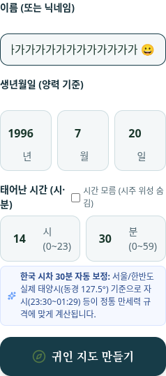
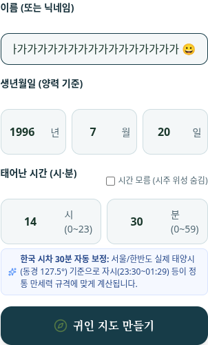
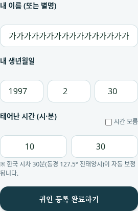
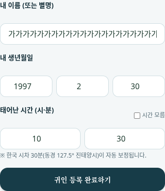

# 지도 이름 폼의 브라우저 QA와 최소 수정

시작 시 기존 작업 트리의 clean 상태와 실제 원격 `b36e98d989a36d098bb3668f89f3d35a8dc1cfa9`을 확인하고, 별도 `qa/map-name-forms-20261010` 브랜치를 만들었다. 실제 소유자 폼과 주변인 폼을 Chromium에서 제출해 저장·닫기·재열기·새로고침 후 UI 이름과 저장 이름을 대조했다. 기존 API 검사처럼 직접 POST로 자료를 만들지 않는다. 테스트용 스키마를 준비한 뒤 모든 쓰기는 브라우저의 폼에서 발생한다.

소유자 폼에서 두 문제가 재현됐다. 50단위 경계를 넘는 이름은 API에서 정상 저장돼도 브라우저 세션의 원본 이름과 달라 이동 단계에서 오류가 났다. 정확히 50단위인 이름은 생성 후 세션의 40단위 제한에 걸려 재열기·새로고침 시 사라졌다. `calculateUniverse`가 공유 파서의 첫 결과를 `birth.name`에 보존하도록 하고, 세션 decoder의 이름 한도를 기존 API와 같은 50 UTF-16 단위로 맞췄다. 사주 계산 결과와 다른 입력 필드는 그대로이며, 입력 객체도 수정하지 않는다.

320px에서는 소유자 폼의 연도 마지막 숫자가 잘렸다. 네 자리의 실제 글자 너비는 약 36.6px였지만 Chromium 기본 숫자 버튼을 제외한 편집 영역은 24.1px였다. 360px 미만에서 년·월·일 단위를 입력 아래줄에 배치해 320px의 연도 편집 영역을 41px로 확보했다. 390px에서는 기존 가로 배치와 45.1px 편집 영역을 유지한다. 카드 여백·폰트·숫자 버튼·검증 규칙은 그대로다.

검사 이름은 일반 이름의 바깥 공백, `'가'.repeat(48) + ' 😀'`, `'가'.repeat(49) + '😀'`, `'가'.repeat(48) + '😀'`의 네 사례다. 경계 사례의 저장 이름은 각각 48·49·50단위다. 두 화면 폭의 8개 조합을 실제 폼에서 검사했다.

| 검사 | 원본 | 수정 후 |
| --- | --- | --- |
| 브라우저 폼 검사 65개 | 20개 실패: 이름·세션 12개, 연도 표시 8개 | 모두 통과 |
| 프런트 세션 검사 7개 | 3개 실패 | 모두 통과 |
| 기존 이름 파서 검사 28개 | 기존 검사 보존 | 모두 통과 |
| 타입·빌드·변경 코드 ESLint | 원본 빌드 성공; 타입·lint 대조 미실행 | 종료 코드 0; lint 오류 0개·기존 경고 1개 |

ESLint 경고는 `app/guin/page.tsx:59`의 기존 `window.location.assign()`에 대한 것이다. 기준 커밋에도 같은 호출이 있으며 이번 수정에서는 변경하지 않았다.

폼 검사에는 소유자 이름의 저장·화면 표시·폼 재진입·새로고침, 주변인 초안의 닫기·재열기, 저장 후 카드 표시·모달 재열기·새로고침·실제 저장값 재조회가 포함된다. 주변인 저장 후 새 초안이 비워지는 기존 동작을 확인하고, 저장된 이름은 카드와 재조회 결과에서 유지되는지 확인했다. 닫기나 새로고침이 추가 저장 요청을 만들지 않는지도 검사한다. 잘못된 2월 30일 입력의 오류 처리와 초안 보존도 확인했다.

소유자·주변인의 일반 상태와 오류 처리 후 상태를 합쳐 32개 폼 배치를 측정했다. 모든 입력·버튼이 폼과 화면 폭 안에 있고 페이지의 가로 넘침이 없었다. 숫자 텍스트는 Canvas의 실제 폰트 측정과 Chromium의 `editing-view-port` box를 비교한다. 제출 버튼 중심이 고정 하단 메뉴에 가리지 않는지도 확인한다. 이름 텍스트는 입력 상자 안에서 가로로 스크롤할 수 있으며, 실제 입력값 전체를 대조한다.

오류 표시는 기존 브라우저 기본 `alert`다. 오류 문구, 팝업 처리, 오류 후 입력 유지와 폼 배치는 검사했다. 네이티브 팝업 자체의 외곽 크기는 헤드리스 페이지 DOM으로 측정할 수 없어 검증하지 않았다. 실제 모바일 기기·키보드·운영 로그인·운영 DB도 사용하지 않았다. 소프트웨어 WebGL로 실제 지도 UI를 로드하지만 3D 외형의 시각 검증은 이 QA 범위에 포함하지 않는다.

아래는 경계 입력을 넣은 실제 폼이다. 주변인 이미지는 기본 오류 팝업을 처리한 뒤의 입력 상태다.

| 폼 | 320px | 390px |
| --- | --- | --- |
| 소유자 |  |  |
| 주변인 |  |  |

실행 환경은 Node `24.19.0`, Playwright `1.62.1`, Chromium `151.0.7922.173`이다. 모든 신원·이름·생년월일은 합성이고 D1은 영속 저장하지 않는다. 외부 호출과 브라우저 예외는 없었다. 일반 clone에서 다음과 같이 재실행한다. Chromium 경로는 설치된 브라우저에 맞게 지정한다.

```bash
npm run install:ci
npm install --prefix /tmp/saju-map-qa --no-save --package-lock=false playwright@1.62.1
export SAJU_QA_PLAYWRIGHT_PATH=/tmp/saju-map-qa/node_modules/playwright/index.mjs
export SAJU_QA_CHROME=/usr/bin/chromium
node --test --test-reporter=tap scripts/qa/map-name-session.mjs
node --test --test-reporter=tap scripts/qa/name-normalization.mjs
npx tsc --noEmit --incremental false
npx eslint app/guin/page.tsx lib/universe-state.ts scripts/qa/map-name-forms-browser.mjs scripts/qa/map-name-session.mjs
npm run build
node scripts/qa/map-name-forms-browser.mjs
```

원본 실패는 기준 커밋의 별도 작업 트리에 현재 검사 파일만 복사해 재실행한다. 두 검사 명령의 종료 코드 1은 각각 3개·20개 불일치의 기대 결과다. shallow clone이면 먼저 기준 커밋의 Git 객체를 가져와야 한다. `SAJU_QA_PHASE`는 보고서 이름만 선택한다.

```bash
saju_map_replay_checkout=$(mktemp -d)
git worktree add --detach "$saju_map_replay_checkout" b36e98d989a36d098bb3668f89f3d35a8dc1cfa9
cp scripts/qa/map-name-session.mjs scripts/qa/map-name-forms-browser.mjs "$saju_map_replay_checkout/scripts/qa/"
ln -s "$PWD/node_modules" "$saju_map_replay_checkout/node_modules"
(
  cd "$saju_map_replay_checkout"
  node --test --test-reporter=tap scripts/qa/map-name-session.mjs
  npm run build
  SAJU_QA_PHASE=before node scripts/qa/map-name-forms-browser.mjs
)
```

폭과 사례를 좁히려면 `SAJU_QA_FORM_WIDTH=320 SAJU_QA_FORM_CASE=ordinary`를 추가한다. 보고서에는 실제 coverage를 기록하므로 이 실행을 전체 65개 통과로 해석하지 않는다. 원시 로그·전후 JSON·나머지 스크린샷은 Git에서 제외되는 `outputs/map-name-forms/`에 보존했다. 초기 QA의 이동 직후 응답 body 소실은 실제 서버 응답을 읽은 뒤 그대로 전달하는 방식으로 해결했다. CSS 너비만으로 숫자 표시를 판단했던 검사도 Chromium의 실제 편집 영역 측정으로 보강한 뒤 원본과 수정본을 모두 재실행했다.

이전 이름 파서·날짜 수정, API·DB·사주 정책, 모델·재질은 변경하지 않았다. 앱 변경은 세션 이름 처리와 소유자 폼의 좁은 화면 배치에 한정한다. main·기존 브랜치·PR·배포·인증 및 권한 변경은 수행하지 않는다.
