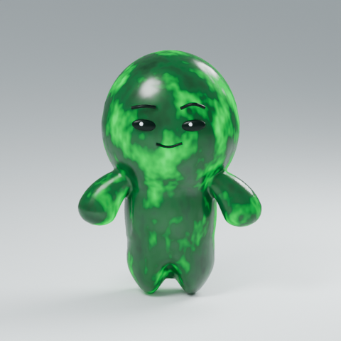
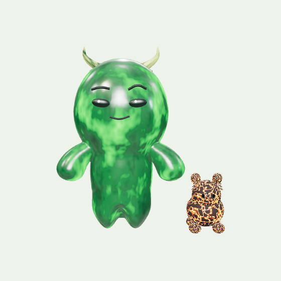
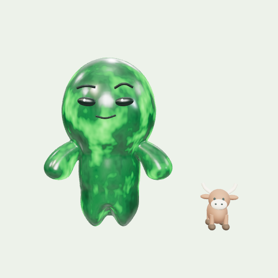
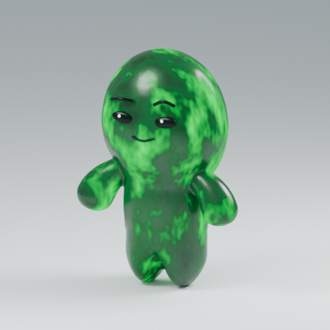
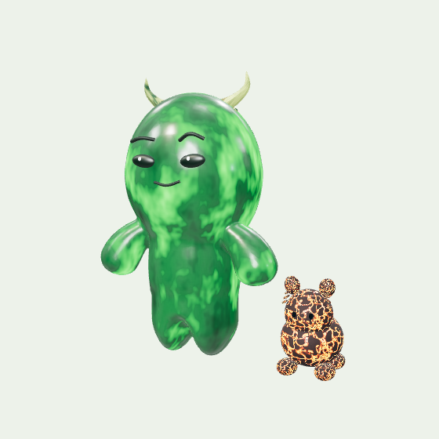
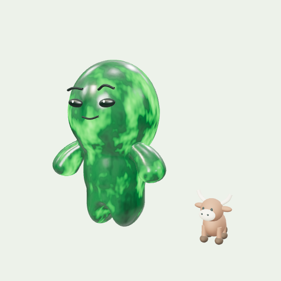
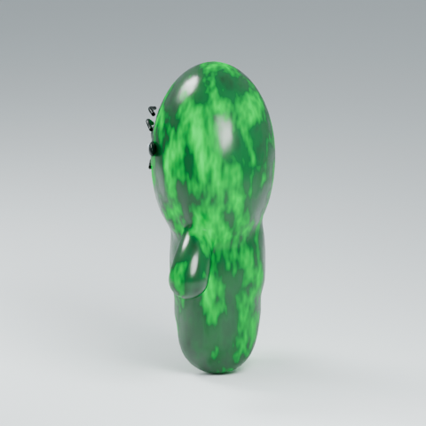
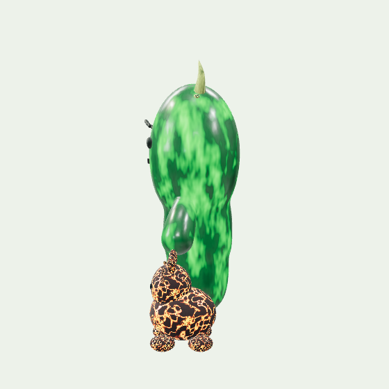
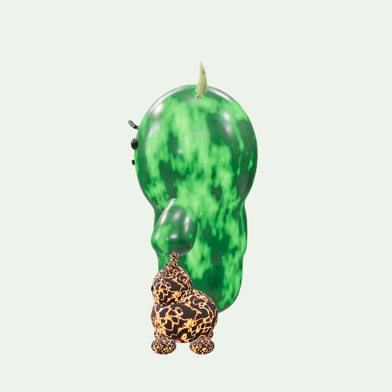
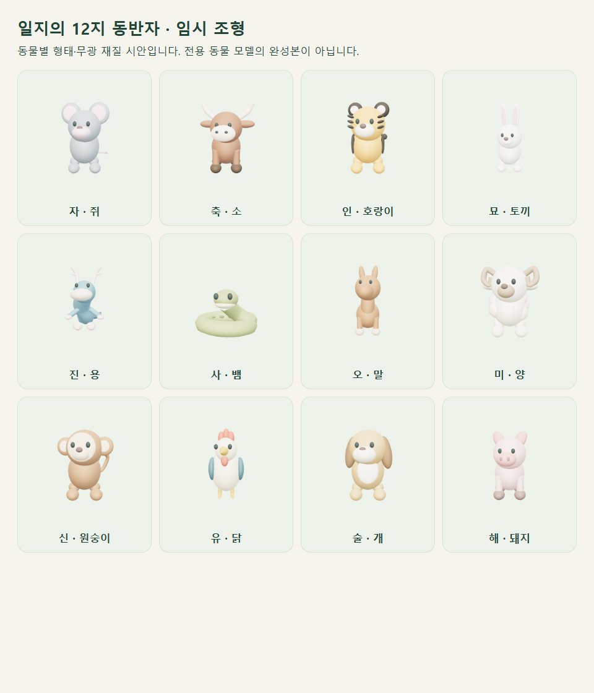

# v24 정령 두께·일지 동반자 수정

현재 비공개 배포 버전 24는 보존했습니다. 이 문서와 기능 브랜치는 검토할 수정본이며, 새 Site 배포나 PR 병합을 하지 않았습니다.

## 확인한 원인

웹의 B 몸체에 눌린 축이나 정규화 오류는 없었습니다. 원본 Blender 몸체 스케일은 `(1,1,1)`이고, GLB 몸체에도 비균일 스케일이 없습니다. 눈에만 원본의 의도된 작은 스케일이 있습니다. Blender의 Z-up → glTF의 Y-up 변환 때문에 원본 Y 방향의 깊이가 웹에서는 Z 방향입니다.

| 중립 몸체의 실제 치수 · 모델 단위 | 원본 / v24 | 수정본 |
| --- | ---: | ---: |
| 폭 X | 1.754512906 | 1.754512906 |
| 높이 Y | 2.384797894 | 2.384797894 |
| 앞뒤 깊이 Z | 0.951007634 | 1.283860306 |

GLB의 비활성 포즈 morph까지 포함한 일반 bounding box는 실제 중립 몸체보다 큽니다. 위 치수는 중립 정점 33,207개의 실제 위치로 계산했습니다. 원본 자체가 얇으므로 조명·카메라만 바꿔 해결했다고 주장하지 않습니다.

원본은 정사영 카메라, AgX Medium High Contrast, 면광과 바닥 그림자를 사용합니다. 웹은 38° 원근 카메라, ACES와 PMREM 반사광을 사용합니다. 동일 웹 설정에서 정면·25° 사선·90° 측면, 깊이만 변경한 경우, 조명·톤매핑·그림자만 변경한 경우를 분리해 비교했습니다. 실제 두께 수정은 메시 전체의 앞뒤 변환입니다. 웹의 노출·톤매핑·기존 광원 강도는 유지했고, 발밑 그림자와 월령 색의 밝은 배경만 추가했습니다.

| 원본 렌더 | v24 웹 참조 | 깊이 수정 비교 |
| --- | --- | --- |
|  |  |  |
|  |  |  |
|  |  |  |

정면·사선 수정본에는 최종 역할·펫 변경도 적용되어 있습니다. 마지막 측면 열은 원인을 분리한 깊이 전용 실험이므로 v24의 이전 펫·장식이 그대로 보입니다. 최종 펫·배치 수정은 아래 화면과 별도 비교 이미지로 확인합니다. 원본과 웹의 조명·투영은 다르므로 픽셀 동일성 비교는 아닙니다.

## 실제 변경

`APPROVED_BODY_PRESENTATION_DEPTH = 1.35`를 모델 루트의 Z 스케일로 적용했습니다. 원본 B 파일의 파생 표현이며, 승인된 원본 파일의 재승인이나 원본 조형 변경을 뜻하지 않습니다. 몸체와 함께 눈·눈썹·입도 같은 루트 변환을 받아 얼굴을 따로 떼거나 팔을 별도로 늘리지 않습니다. 팔은 원래 연결된 몸체 메시 안에 있습니다. 앞에서 본 모델 좌표의 폭·높이는 유지되고, 원근 투영에서 가까워진 부분의 픽셀 크기·반사는 달라질 수 있습니다.

원본 POSITION·UV·중립 morph와 v002 셰이더·아틀라스·녹색 강도 2를 유지했습니다. 발광은 변형 전 메시의 로컬 좌표를 계속 읽습니다. 앞뒤로 늘어난 표면 위에서 무늬도 함께 늘어나지만, 새 노이즈 좌표를 만들거나 시간에 따라 좌표를 밀지 않습니다. 6초 세 필드 혼합과 반사 격리 계약은 그대로입니다.

런타임 B GLB SHA-256: `0e339d90253c8bbf6a865210f39d200ec3b5c042bcddb7ce669cea5c75c37b84`.

역할을 일간 정령·월령 배경·일지 동물 펫으로 수정했습니다. v24의 월간 원소 재질·월지 펫과 정령 머리의 일지 장식을 제거했습니다. 월령 배경은 기존 월간 재질에서 가져온 밝은 색조와 월령 표기이며, 계절 레이어나 대기 구체를 추가하지 않았습니다. 행성의 일주 70%·월주 30%·시주 위성·연주 소행성대는 유지합니다.

동반자는 정령과 다른 자연색·무광 재질이며 발광하지 않습니다. 일지를 바꾸면 동물이 바뀌고, 월령을 바꿔도 그 동물은 유지됩니다. 크기는 정령 높이의 약 20–28%이고, 땅 위의 오른쪽에 둡니다. 정령의 회전만 분리해 측면에서도 펫이 주인 뒤로 이동하지 않습니다. 미세한 고개 움직임은 주인을 향하는 작은 시선입니다. 발바닥은 높이 0에 놓이고 두 모델의 접촉·겹침을 확인했습니다.

| 지지 | 동물 | 지지 | 동물 | 지지 | 동물 |
| --- | --- | --- | --- | --- | --- |
| 자 | 쥐 | 축 | 소 | 인 | 호랑이 |
| 묘 | 토끼 | 진 | 용 | 사 | 뱀 |
| 오 | 말 | 미 | 양 | 신 | 원숭이 |
| 유 | 닭 | 술 | 개 | 해 | 돼지 |



## 미완료와 검증 범위

**확인한 프로젝트 리소스에는 전용 12지 동물 모델이 없습니다.** 현재 것은 동물별 귀·코·꼬리·발·몸통을 구분한 절차형 임시 조형입니다. 완성된 동물 모델·텍스처·리그로 보고하지 않습니다. 화면과 객체 메타데이터에도 임시 상태를 표시합니다. 전용 동물 리소스 제작·승인·교체가 남아 있습니다.

- [수정 전 실제 v24 화면](qa/spirit-depth-pets/before-site-v24.png)
- [수정 후 정면](qa/spirit-depth-pets/after-front.png), [사선](qa/spirit-depth-pets/after-oblique.png), [측면](qa/spirit-depth-pets/after-side.png)
- [390px 실제 앱 정면](qa/spirit-depth-pets/after-mobile-front.png), [측면](qa/spirit-depth-pets/after-mobile-side.png)
- [깊이·얼굴·12지 검사](qa/spirit-depth-pets/depth-pets-report.json), [앱 브라우저 회귀 검사](qa/spirit-depth-pets/browser-report.json), [원본 Blender 확인 값](qa/spirit-depth-pets/native-inspection.json)

| 검사 | 결과 |
| --- | --- |
| TypeScript·생산 빌드 | 통과. 의존성·잠금 파일 변경 없음. |
| 깊이·펫 검사 | 6개 그룹 통과. 원본 POSITION 해시·중립 morph·얼굴 부착·정면/사선/측면 분리·12지×두 품질·바닥 접촉·월령 독립성·동물 눈 가림·기존 팩토리 확인. |
| 실제 앱 브라우저 | 12개 그룹 통과. 320/390/768/1440px, 일지 펫·월령 배경, 발광·일시정지, 세 화면 WebGL 복구, 입력·Back/Forward·새 탭, 모바일 터치·공유·대체 화면. 오류·외부 요청 0개. |
| 기존 API·DB 통합 | 23개 통과. 가상 사용자·폐기하는 로컬 D1·가상 Gemini만 사용. |
| 원본 보존·발광 | 46개 파일과 아틀라스 보존 검사, CPU 10개, GPU 108개 표본 통과. |
| 변경 코드 ESLint | Canvas를 제외한 대상 7개 파일 통과. Canvas에는 기준 커밋에도 있던 `react-hooks/set-state-in-effect` 오류 1개와 `` 경고 1개가 남음. [기준 검사](qa/spirit-depth-pets/baseline-lint.json). 전체 lint 통과라고 주장하지 않음. |
| 독립 코드 검토 | 수정 소스에서 조치할 지적 없음. 브라우저 검사는 별도 직접 실행. |

Chrome SwiftShader와 합성 터치로 확인했으며 물리 기기 GPU·실제 로그인·운영 Web Vitals를 검증하지 않았습니다. `.openai/hosting.json`, API/DB/인증 코드와 배포 공개 범위를 바꾸지 않았습니다. 기존 비공개 v24와 v23 복구본은 유지하며, 새 배포는 검토 후 별도 진행합니다.

재현 명령:

```text
node scripts/qa/spirit-depth-pets.mjs
node scripts/qa/universe-browser.mjs
node scripts/integration-preview.mjs
node scripts/qa/verify-approved-assets.mjs
node --test assets/source-reference/saju-b-evolving-light-v002/runtime/tests/saju-jade-evolution.test.mjs
node node_modules/typescript/bin/tsc --noEmit
node node_modules/vinext/dist/cli.js build
```
