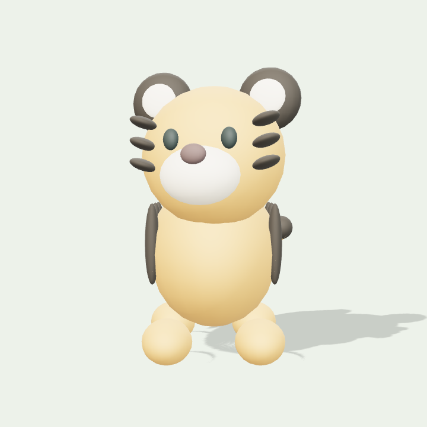
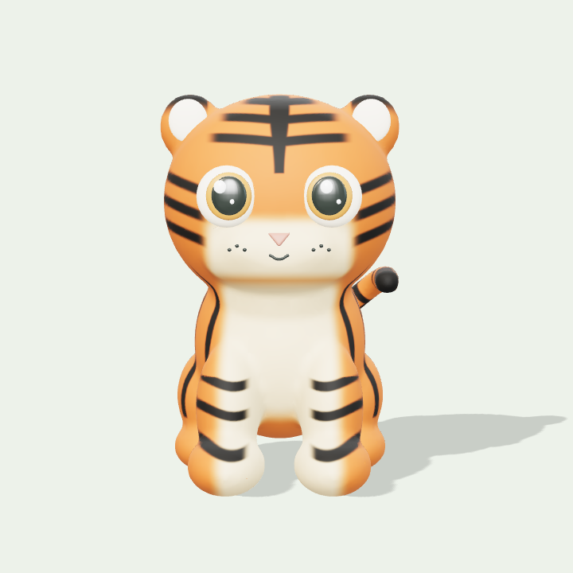
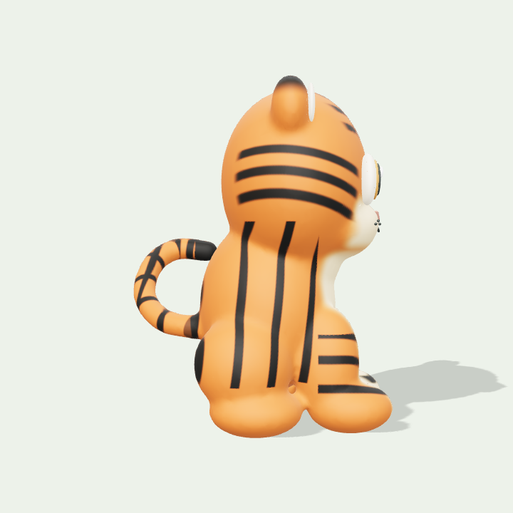

# 새 호랑이 모델 후보 v001

이 호랑이는 접근 가능한 작업 기록과 기존 임시 조형을 참고해 새로 제작한 **미승인 후보**입니다. 소실된 최신 호랑이 원본을 찾거나 동일하게 복원한 결과가 아닙니다. 원본 동물 회수 수는 0이며, 새 제작 모델은 호랑이 1종입니다. 기존 아카이브 조사 범위와 알려진 용·돼지의 소실 후보 해시는 [원본 조사](qa/zodiac-pet-assets/README.md)와 manifest에 보존했습니다.

브랜치 `rebuild/tiger-authored-model-20261010`은 `ee6e9740054394b0bee30563f35e957b49adf4bb`에서 시작했습니다. 별도로 검증한 불꽃 카드 그림자·동시간 QA 후속 수정 `f7e99f144223d1497238767c26d10ec9f6e2002b`을 그대로 포함합니다. 이 후보는 배포하지 않았습니다.

## 제작과 연결

- [Blender 원본](../assets/source-reference/tiger-reconstructed-v001/Tiger_Reconstructed_v001.blend), [직접 제작한 코팅 PNG](../assets/source-reference/tiger-reconstructed-v001/Tiger_Coat_v001.png), [재생성 스크립트](../scripts/authoring/build-tiger-reconstructed-v001.py), [제작 recipe](../assets/source-reference/tiger-reconstructed-v001/recipe.json), [runtime GLB](../public/models/zodiac-pets/tiger-reconstructed-v001.glb)을 새 경로에 보존했습니다. 외부 모델·이미지·구매 에셋을 사용하지 않았습니다.
- 몸·목·짧은 네 다리·귀·말린 꼬리는 겹친 조형 씨앗을 voxel 합집합으로 처리하고 관절을 평활화한 하나의 닫힌 연속 메시입니다. 숨긴 편집용 씨앗은 `.blend`에만 남고 GLB에 내보내지 않습니다. 몸체 31,464개, 눈·귀 안쪽·코·입 등 포함 전체 45,160개 삼각형, 21개 메시입니다.
- 이마·볼·등·다리·꼬리 줄무늬와 크림색 주둥이·배는 직접 작성한 3D 색상 필드를 새 몸체 UV에 평가해 2048×2048 PNG로 생성했습니다. GLB에 이미지를 포함하므로 외부 이미지 요청이 없습니다. 몸 재질은 금속성 0, 거칠기 약 0.79이며 둥근 눈의 반짝임은 자체 제작 재질의 반사입니다.
- `TigerIdle`은 5초 루프입니다. 가슴의 작은 호흡, 고개와 꼬리 움직임만 있고 발과 루트는 움직이지 않습니다. 로더는 manifest가 지정한 이 원본 클립을 절대 시간으로 재생해 일시정지·초기화·되감기·프레임 속도 차이를 처리합니다. 폐기할 때 mixer action과 binding을 해제하고 원본 자원을 한 번만 폐기합니다.
- manifest의 `인` 항목만 `available / new-reconstruction / new-candidate-unapproved`로 바꾸었습니다. 다른 11종 항목과 기존 원본 파일은 그대로입니다. fallback의 기존 조형·재질·idle 함수도 수정하지 않았습니다. 표시용 바깥 그룹만 균일 축소하고 중심과 바닥을 맞추며, 일지 동물 배치 `(1.10, 0, .12)`를 유지합니다.

## 실제 WebGL 확인

| 기존 임시 호랑이 | 새 정면 | 새 측면 |
| --- | --- | --- |
|  |  |  |

[사선](qa/tiger-reconstructed-v001/new-oblique.png), [승인 B 정령과 함께](qa/tiger-reconstructed-v001/pair-front.png), [측면 정령과의 분리](qa/tiger-reconstructed-v001/pair-side.png), [idle 초기](qa/tiger-reconstructed-v001/idle-0.png), [1.25초](qa/tiger-reconstructed-v001/idle-1_25.png), [3.75초](qa/tiger-reconstructed-v001/idle-3_75.png), [5초 루프 끝](qa/tiger-reconstructed-v001/idle-5.png).

실제 GLB·PNG·skin·idle를 로드한 로컬 Chromium SwiftShader 캡처 14장과 십간×high/low 20개 로드·회전 검사를 수행했습니다. 새 호랑이는 각 경우 실제 `authored-glb`로 로드됐고 셰이더·브라우저 오류와 외부 요청은 0개입니다. 정령의 기존 POSITION·UV 해시와 깊이 1.35는 보존됐으며 불꽃 카드의 그림자는 비활성, 몸체 그림자는 유지됩니다. 임시 정령을 폐기한 뒤 메모리 수치는 20회 모두 동일합니다. 마지막 동물·정령 폐기 후 renderer 종료 직전 값은 geometry 0개, texture 4개입니다. 동물의 각 자원 폐기와 mixer 해제는 CPU 검사에서 별도로 확인했으며, GPU texture 수가 0이라는 주장은 하지 않습니다.

## 검증과 재생성

[검증 요약](qa/tiger-reconstructed-v001/verification-summary.json), [실제 WebGL 보고서](qa/tiger-reconstructed-v001/report.json), [CPU 결과](qa/tiger-reconstructed-v001/cpu-tests.tap), [재생성 비교](qa/tiger-reconstructed-v001/regeneration-report.json).

CPU 13개 검사는 실제 GLB의 닫힌 manifold·단일 연결 몸체, 원본 코팅 PNG의 GLB 포함, skin·idle·발 고정·루프·되감기·초기화·프레임 독립성, mixer binding 해제, 독립 자원 소유·중복 폐기·abort·SHA 불일치 대응을 확인합니다. 기존 `assets`/`public` 파일 전체와 나머지 11개 manifest 항목의 동일성도 검사합니다. TypeScript, 생산 빌드, 변경한 TypeScript·QA 파일 lint와 승인된 B 원본/아틀라스 보존 검사가 통과했습니다.

```sh
blender --background --factory-startup --threads 1 --python scripts/authoring/build-tiger-reconstructed-v001.py
node --test scripts/qa/zodiac-pet-loader.mjs scripts/qa/tiger-authored-asset.mjs
SAJU_QA_PLAYWRIGHT_PATH=/absolute/path/to/playwright/index.mjs node scripts/qa/tiger-authored-browser.mjs
node node_modules/typescript/bin/tsc --noEmit
npm run build
```

Blender 4.3.2에서 새로 실행한 두 결과의 모든 21개 메시의 정점·삼각형·노말·skin, 장면·재질과 idle 채널/샘플 데이터는 일치했습니다. Blender UV island packing은 달라질 수 있어 PNG와 전체 GLB 바이트 해시의 동일성은 보장하지 않습니다. generator는 해당 새 호랑이 버전이 선택되어 있을 때 그 항목의 SHA만 실제 생성 결과로 갱신합니다. 각 내보내기의 실제 SHA는 recipe에 기록하며, 재생성한 뒤 검사를 다시 실행해야 합니다. 비교하려면 앞선 GLB를 `/tmp`에 보존하고 재생성한 뒤 `node scripts/qa/tiger-regeneration-compare.mjs /tmp/tiger-before.glb`를 실행합니다.

물리 기기 GPU, 실제 hosted 로그인 화면과 사용자의 최종 외형 승인은 확인하지 않았습니다. 다른 11종의 새 전용 모델 제작과 소실된 최신 원본 확보는 남아 있습니다. 이번 호랑이는 private 검토 후보이며 사이트 배포·main 병합·PR 생성·권한 변경을 포함하지 않습니다.
